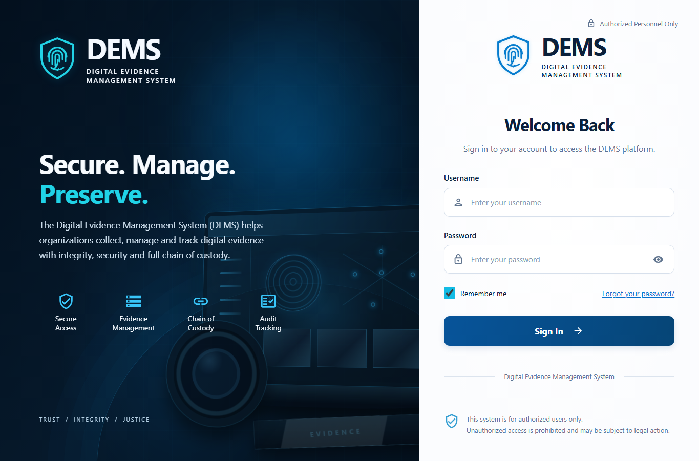
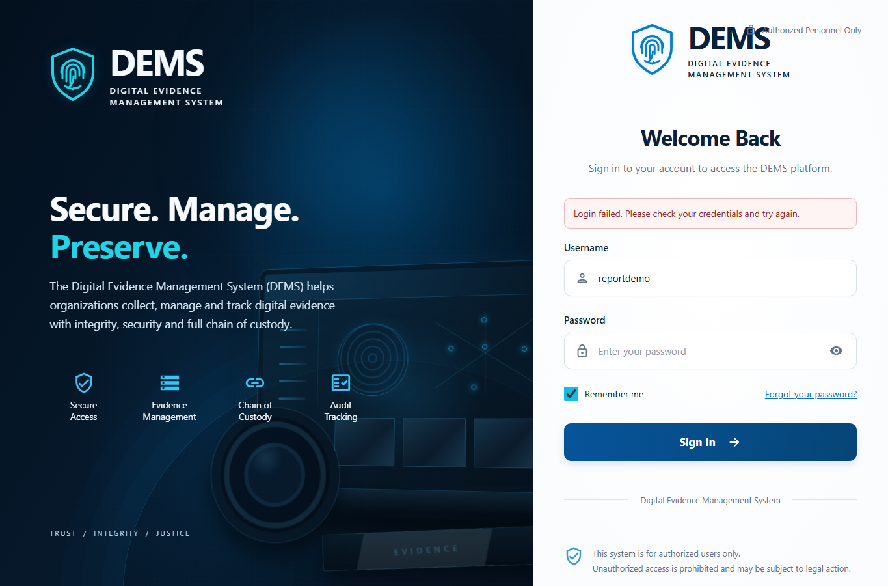
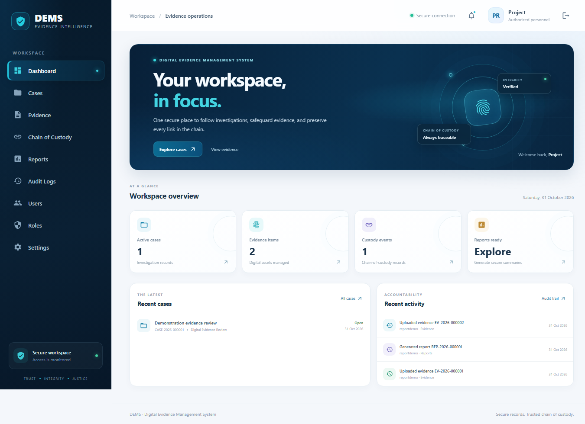
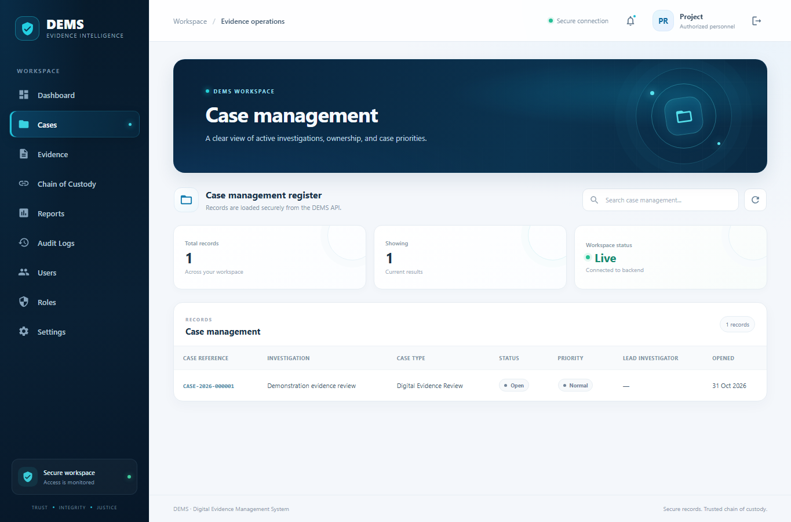
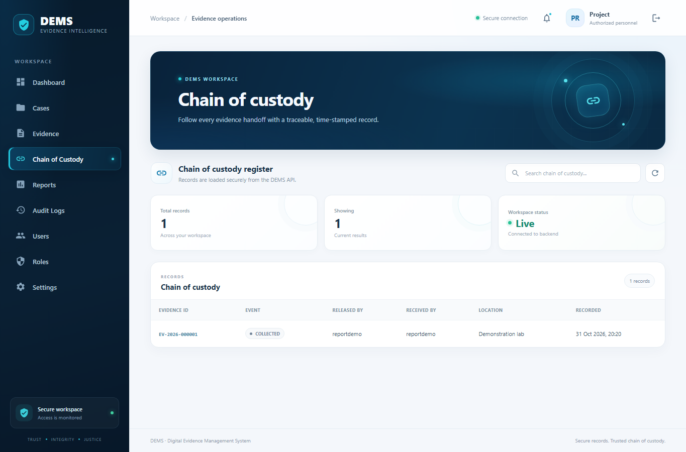
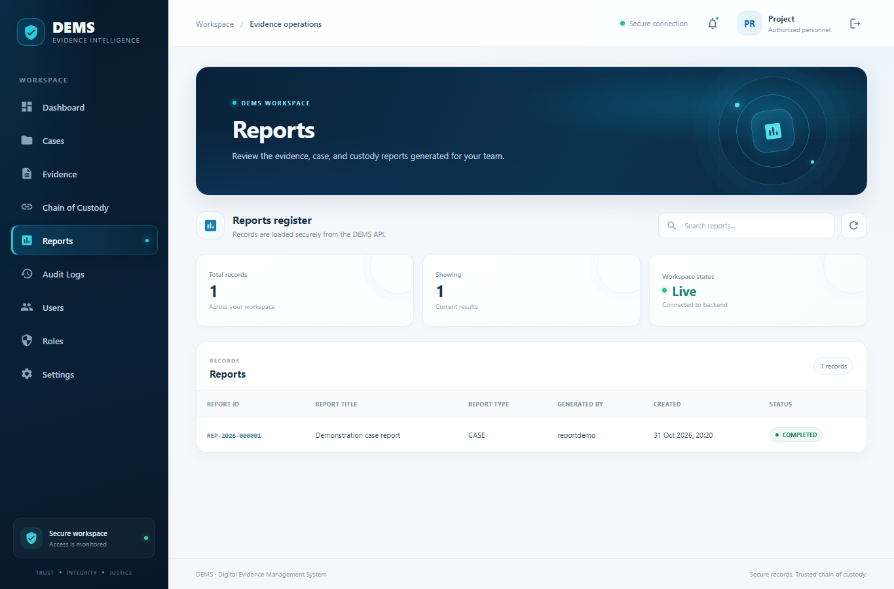

# DEMS interface screenshots

These screenshots show the DEMS React interface running locally against a development API. All case, evidence, account, custody, and report data shown is synthetic preview data created for demonstration; it is not operational or investigative evidence.

| Screenshot | Description |
| --- | --- |
| `react-login.png` | Sign-in page before credentials are entered. |
| `react-login-validation.png` | Sign-in page displaying a safe message after intentionally invalid test credentials. The password field is blank. |
| `react-dashboard.png` | Authenticated dashboard with summary cards, a recent case, and synthetic audit activity. |
| `react-cases.png` | Case register in the React workspace. |
| `react-evidence.png` | Evidence register showing synthetic records and their displayed integrity status. |
| `react-custody.png` | Chain-of-custody register showing a synthetic custody record. |
| `react-reports.png` | Reports register showing a synthetic report record. |

These images document the local development interface only. They are not evidence of a production deployment, complete authorization testing, or user acceptance.

## Gallery

